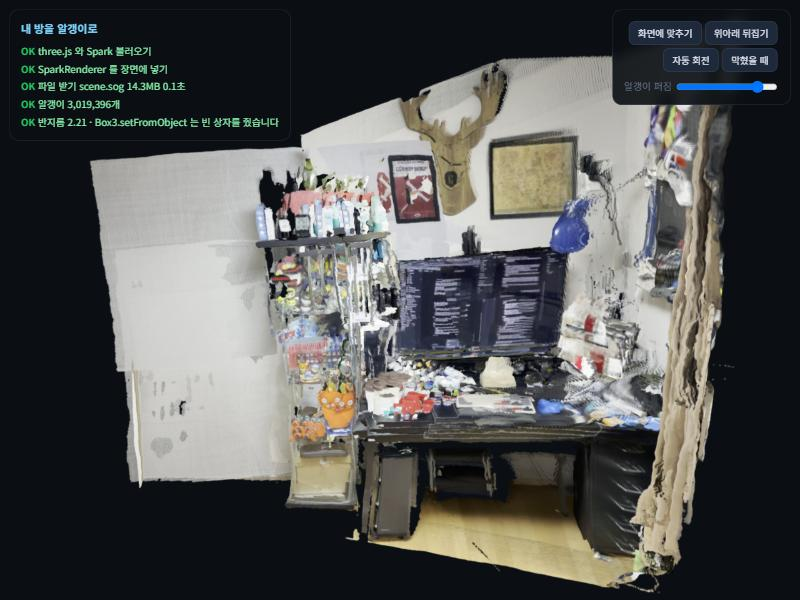
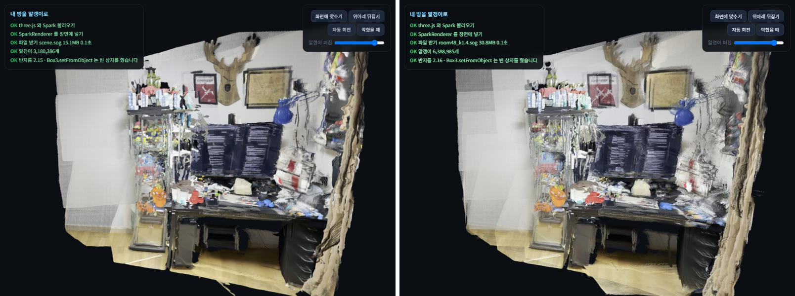
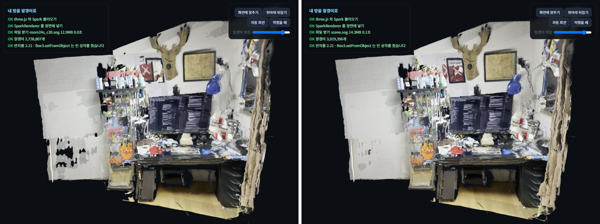
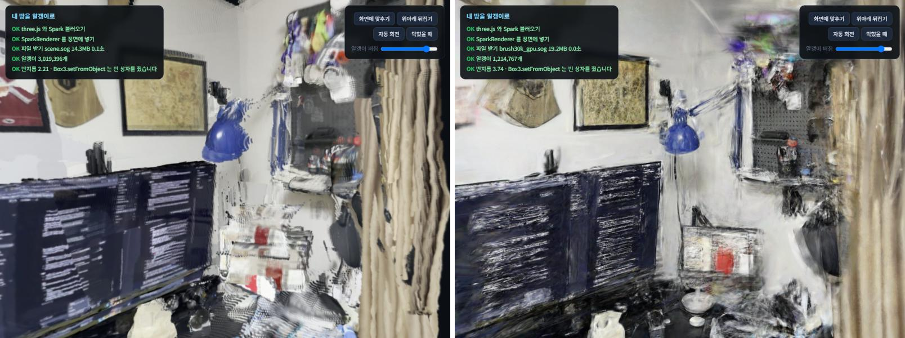
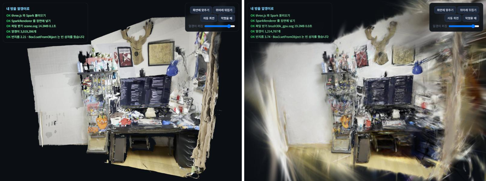

# 내 방을 알갱이로 — 폰 영상 하나로 만든 3D 방

폰으로 30초 찍은 방 영상에서 3차원 장면을 만들어 웹에 올렸습니다.
복원은 코랩이 아니라 **내 컴퓨터의 Intel Arc A770**에서 했고, 같은 데이터로
**Brush 3DGS 학습**까지 비교했습니다. 같은 복원을 **코랩 T4** 에서도 돌려 결과가 같은지 확인했습니다.

**보기** https://zslayer-dev.github.io/my-room-3d/ (공개본)
· **Brush 3DGS 학습본** https://zslayer-dev.github.io/my-room-3d/?f=compare/brush30k.sog



```
영상 30.5초 ─► 후보 144장 ─► 가장 선명한 24장 ─► MapAnything(A770) ─► 점 302만 개
   ─► 알갱이(K=1.4) ─► scene.ply 205MB ─► scene.sog 15MB ─► GitHub Pages
                                    └─► (비교) Brush 3DGS 학습 30,000스텝 ─► brush30k.sog
```

## 공개 판단

내 방의 책상 코너만 찍었고, 사람 얼굴·주소·문서는 화면에 없습니다. 모니터 두 대가 켜져 있었지만
모델이 사진을 518×294로 줄여 쓰기 때문에 장면 안에서 글자가 읽히지 않는 것을 확대해 확인했습니다.
원본 영상과 1280px 프레임은 글자가 보일 수 있어 **저장소에 올리지 않았습니다.**

## 촬영

| 항목 | 값 |
|---|---|
| 대상 | 내 방 책상 코너 (모니터, 유리 진열장, 벽 장식, 커튼) |
| 경로 | 책상을 바라보며 왼쪽 진열장 앞 → 책상 → 오른쪽 커튼까지 원호로 걸음, 마지막에 진열장 쪽으로 돌아옴 |
| 영상 | 30.5초, 3840×2160 가로, 60fps, HEVC |
| 프레임 | 144장 후보를 6장씩 묶어 가장 선명한(라플라시안 분산 최대) 1장 → **24장** |
| 선명도 | 후보 최저 40 → 고른 장 최저 95 (중앙값 548 → 761) |

## 계산 환경

| | |
|---|---|
| GPU | Intel Arc A770 16GB (NVIDIA·CUDA 없음, Windows 11) |
| PyTorch | 2.15.0+xpu (Intel GPU 공식 빌드) |
| 모델 | `facebook/map-anything-apache` (Apache-2.0), fp16 |
| 알갱이 변환 | splat-transform 3.10.3 (SOG v2) |
| 뷰어 | three.js 0.180.0 + Spark 2.4.0 |

### A770에서 막힌 곳과 해결

MapAnything 코드는 장치 이름을 고정하지 않아 `xpu` 로 그대로 돌았지만, 한 곳에서 프로세스가 죽었습니다.

- **증상**: 추론(forward)은 끝나는데 후처리에서 `AssertHandler::printMessage` 와 함께 access violation.
- **원인**: 후처리의 작은 선형대수(`torch.linalg.solve` 등) 커널이 Arc 드라이버에서 실패. 비동기라 다음 `.cpu()` 에서 드러남.
- **해결**: `model.infer()` 를 풀어 **forward 는 A770, 후처리는 CPU**에서 실행 ([scripts/recon_xpu.py](scripts/recon_xpu.py)).

## 복원 결과 (모두 A770, fp16)

| 버전 | 프레임 | forward | 최대 GPU 메모리 | 점 (튄 점 제외) | 카메라 퍼짐 비 |
|---|---|---|---|---|---|
| 처음 24장 (고르게 뽑기) | 24 | 9.0초 | 6.75GB | 3,180,386 | 0.480 |
| 48장 | 48 | 12.9초 | 8.50GB | 6,388,985 | 0.494 |
| 선명한 24장 + 신뢰도 하위 20% 제거 | 24 | 9.3초 | 6.75GB | 2,738,807 | 0.451 |
| **선명한 24장 + 신뢰도 하위 10% 제거 (공개본)** | 24 | 9.9초 | 6.75GB | **3,019,396** | **0.451** |

카메라 퍼짐 비 = 카메라 위치 상자의 대각선 ÷ 장면 상자의 대각선. 0.45 로 기준 0.1 보다 훨씬 커서
**제자리 회전이 아니라 걸으며 찍은 것**이 수치로도 확인됩니다. 실제로 진열장 앞에서 커튼 앞까지
약 2m 를 걸었고, 추정된 카메라 퍼짐(1.99m)과 맞습니다.

알갱이 반지름은 `K × 장면의 가장 긴 변 ÷ √N` = 1.4 × 3.071 ÷ √3,019,396 = **0.00247**.

## 형식별 크기 (공개본, 알갱이 3,019,396개)

| 형식 | 바이트 | 변환 시간 | 알갱이당 | PLY 대비 |
|---|---|---|---|---|
| `.ply` (17 floats) | 205,319,345 | — | 68.0B | 1× |
| `.compressed.ply` | 49,160,238 | 6.1초 | 16.3B | 4.2× |
| `.spz` | 19,469,308 | 9.9초 | 6.4B | 10.5× |
| **`.sog`** | **14,980,383** | 7.2초 | **5.0B** | **13.7×** |

세 형식 모두 알갱이 개수가 같습니다(개수를 줄인 게 아니라 저장 방식만 바꿈).
GitHub 의 100MiB 한도와 폰 다운로드를 생각해 **SOG** 를 골랐습니다. 크기는 1,000,000 바이트 = 1MB 기준입니다.

## 화질 비교와 개선 시도

### 사진을 늘리면 더 선명할까? → 아니었다


*왼쪽 24장, 오른쪽 48장. 48장은 액자·사슴·모니터 윤곽이 이중으로 보이고 진열장에 줄무늬가 생깁니다.*

MapAnything 은 사진마다 깊이를 따로 추정하고 이를 한 공간에 겹칩니다. 사진 사이에 조금씩 어긋남이
있어서 **장수가 늘수록 어긋난 겹이 쌓여 윤곽이 번졌습니다.** K 를 1.0/1.2/1.4 로 바꿔도 차이는 작았습니다.

### 좋은 사진 고르기 + 신뢰도 필터 → 효과 있음


*왼쪽 하위 20% 제거: 가장 또렷하지만 왼쪽 흰 벽에 구멍. 오른쪽 10% 제거(공개본): 벽이 대부분 메워짐.*

신뢰도 필터는 물체 경계의 줄무늬를 지우지만, **무늬가 없는 흰 벽도 신뢰도가 낮아** 함께 지워집니다.
10% 가 절충점이었습니다.

## Brush 로 진짜 3DGS 학습 (비교용)

공개본은 점에 크기·불투명도를 **규칙으로** 준 것입니다. 사진과 비교하며 알갱이마다 위치·크기·모양·회전·
방향별 색을 **학습**하면 어떻게 다른지 보려고 [Brush](https://github.com/ArthurBrussee/brush) v0.3.0 을 썼습니다.
gsplat 등 대부분의 학습 도구는 CUDA 전용이지만 Brush 는 WebGPU 기반이라 A770 에서 돌았습니다.

| 항목 | 값 |
|---|---|
| 입력 | 공개본의 24장 중 학습 20장 / 평가 4장, MapAnything 카메라, 초기 점 30만 개 |
| 형식 변환 | [scripts/export_brush.py](scripts/export_brush.py) — Nerfstudio `transforms.json` |
| 학습 | 30,000스텝, SH 3차, **19분 42초** (A770) |
| 결과 | 알갱이 1,214,767개, SOG 20,110,457B (알갱이당 16.6B — 방향별 색 포함) |
| 평가 PSNR / SSIM | 5천 스텝 13.14 / 0.449 → 3만 스텝 **12.81 / 0.420** ([로그](results/brush_eval.txt)) |


*촬영 경로 근처 (왼쪽 공개본, 오른쪽 Brush). Brush 가 벽을 매끈하게 채우고 스탠드·타공판·작은 모니터가 또렷합니다.*


*촬영 경로 밖 (왼쪽 공개본, 오른쪽 Brush). Brush 는 가장자리에 줄무늬 잡티가 생깁니다.*

**해석** — 학습 사진이 20장뿐이고 MapAnything 카메라에 몇 픽셀 오차가 있어, Brush 는 학습 사진에만 맞는
길쭉한 바늘 모양 알갱이(가로세로비 중앙값 약 100배)를 만들었습니다. 그래서 **학습할수록 평가 PSNR 이
떨어졌습니다**(과적합). 여러 방향에서 돌려 보는 웹 뷰어에는 공개본이 더 안정적이라 판단했습니다.
더 좋게 하려면 사진을 더 쓰고, COLMAP 으로 카메라를 정밀하게 맞추고, 스텝을 줄여 볼 수 있습니다.

**함정** — Spark 2.4.0 이 Brush 의 `.ply` 를 직접 읽으면 가시 모양으로 깨져 보였습니다
([화면](shots/brush_ply_in_spark_broken.png)). splat-transform 으로 `.sog` 로 바꾸면 정상입니다.
GPU 변환이 처음엔 WebGPU 장치 오류로 실패했고 `-N`(NaN 등 이상값 제거)을 붙여 성공했습니다.
Brush 결과는 MapAnything 좌표(Y 아래)라 `-r 180,0,0` 으로 돌려 저장했습니다.

## 코랩 T4 와 비교

Windows 라 Colab CLI 대신 **Colab MCP** 로 브라우저의 코랩 노트(T4 GPU)에 연결해, 공개본과
**같은 24장·같은 설정**(fp16, 신뢰도 하위 10% 제거)으로 복원했습니다 ([scripts/colab_t4_recon.py](scripts/colab_t4_recon.py)).

| 항목 | A770 (로컬) | T4 (코랩) |
|---|---|---|
| 복원 시간 | 13.6초 | **9.7초** (첫 실행 14.3초) |
| 최대 GPU 메모리 | 6.75GB | 6.99GB |
| 점 (원래 → 튄 점 제외) | 3,102,522 → 3,019,396 | 3,102,500 → 3,019,365 |
| 카메라 퍼짐 비 | 0.4512 | 0.4512 |
| 카메라 위치 차이 | — | 평균 **0.08mm**, 최대 0.15mm |
| 점구름 차이 | — | 중앙값 **0.10mm**, 95% 0.23mm |

([측정 결과](results/compare_a770_t4.txt), [비교 스크립트](scripts/compare_t4.py))

- **결과는 사실상 같습니다.** 장면 대각선 4.41m 에 차이가 0.1mm 대로, fp16 반올림 수준입니다.
- **T4 가 약 30% 빠릅니다.** 다만 첫 실행은 A770 과 비슷하고, 코랩은 모델 내려받기·준비에 160초가 더 듭니다.
  이 정도 작업이면 로컬 A770 으로 충분하고, 코랩은 gsplat 같은 CUDA 전용 도구가 필요할 때 씁니다.
- **함정** — 처음엔 점구름 차이가 5.5mm 로 나왔는데, A770 결과끼리 같은 방법으로 재도 5.51mm 였습니다.
  양쪽 다 20만 개 표본만 쓰면 **표본 사이 간격이 거리로 잡힌 것**이라, 한쪽 표본을 다른 쪽 전체와 비교하도록 고쳤습니다.
- **Colab MCP 설정** — `colab-mcp` 는 파이썬 3.13 이상이 필요해 `uvx --python 3.13` 으로 고정했습니다.
  프로젝트 `.mcp.json` 은 승인 대기로 불러와지지 않아 `claude mcp add -s local` 로 등록했고, 등록 후 새 세션에서 도구가 보였습니다.
  프레임은 코랩 파일 창에 직접 끌어다 놓았습니다(저장소에는 올리지 않음).

## 비교 파일 열기

주소 뒤에 `?f=` 를 붙이면 됩니다.

| 주소 | 내용 |
|---|---|
| [`/`](https://zslayer-dev.github.io/my-room-3d/) | 공개본 (선명한 24장 + 신뢰도 10%) |
| [`?f=compare/room24_k1.4.sog`](https://zslayer-dev.github.io/my-room-3d/?f=compare/room24_k1.4.sog) | 처음 24장 |
| [`?f=compare/room48_k1.4.sog`](https://zslayer-dev.github.io/my-room-3d/?f=compare/room48_k1.4.sog) | 48장 (32MB) |
| [`?f=compare/room24s_c20.sog`](https://zslayer-dev.github.io/my-room-3d/?f=compare/room24s_c20.sog) | 신뢰도 20% |
| [`?f=compare/brush30k.sog`](https://zslayer-dev.github.io/my-room-3d/?f=compare/brush30k.sog) | Brush 3DGS 학습 |

## 한계 — 어디가 안 나왔고 왜

| 자리 | 보이는 모습 | 원인 |
|---|---|---|
| 책상 밑, 진열장 뒤, 의자 뒤 | 비어 있음 / 배경이 비침 | **찍지 않은 면**. 시차가 없으니 점 자체가 없음. K 를 키워도 안 채워짐 |
| 왼쪽 흰 벽 | 작은 검은 얼룩 | **무늬가 없어** 사진끼리 같은 자리를 맞추기 어려움 → 신뢰도가 낮아 필터에 지워짐 |
| 유리 진열장 안 | 흐릿하고 잔상 | 유리는 보는 방향마다 반사가 달라 **사진끼리 정렬이 안 맞음**. 마지막 구간은 흔들린 프레임도 섞임 |
| 커튼 가장자리 | 늘어진 줄무늬 | 물체 경계에서 깊이가 애매한 점들이 앞뒤로 퍼짐 |
| 케이블, 스탠드 팔 | 뭉개짐 | 모델 입력이 518×294 로 줄어 가는 물체가 몇 화소밖에 안 됨 |
| 모니터 글자 | 줄무늬로만 보임 | 같은 이유 (공개에는 유리) |

## 첫 화면까지 걸린 시간

| 기기 | 통신 | 첫 화면 |
|---|---|---|
| 데스크톱 (로컬 서버) | localhost | 파일 받기 0.1초 (15MB) |
| 내 폰 | Wi‑Fi | **1.3초** |
| 다른 사람 폰 | _측정 예정_ | _측정 예정_ |

## 다시 만들기

```bash
# 프로젝트 루트에서
git clone --depth 1 https://github.com/facebookresearch/map-anything.git
python -m venv .venv-xpu
.venv-xpu/Scripts/python -m pip install torch torchvision --index-url https://download.pytorch.org/whl/xpu
.venv-xpu/Scripts/python -m pip install -e ./map-anything

# 복원: 후보 144장 중 선명한 24장, 신뢰도 하위 10% 제거 → out/scene.ply
.venv-xpu/Scripts/python scripts/recon_xpu.py room.MOV --frames 24 --pick 6 --conf-pct 10 --out out

# K 만 바꿔 다시 만들기
.venv-xpu/Scripts/python scripts/make_splat.py out/points.npz out/scene_k1.2.ply --K 1.2

# 줄이기
npx -y @playcanvas/splat-transform@3.10.3 -w out/scene.ply scene.sog

# Brush 학습 (선택)
.venv-xpu/Scripts/python scripts/export_brush.py out --holdout 6
brush_app.exe out/brush --total-steps 30000 --eval-every 5000 --export-path out/brush_30k
npx -y @playcanvas/splat-transform@3.10.3 -w -N out/brush_30k/export_30000.ply -r 180,0,0 brush30k.sog
```

| 파일 | 하는 일 |
|---|---|
| [scripts/recon_xpu.py](scripts/recon_xpu.py) | 영상 → 선명한 프레임 → MapAnything(XPU) → 점·카메라 → 스플랫 PLY |
| [scripts/make_splat.py](scripts/make_splat.py) | 저장한 점에서 K 만 바꿔 PLY 다시 만들기 |
| [scripts/export_brush.py](scripts/export_brush.py) | Brush 용 Nerfstudio 데이터셋 내보내기 (내부값을 원본 해상도로 되돌림) |
| [scripts/check_proj.py](scripts/check_proj.py) | 내보낸 카메라로 점을 사진에 투영해 정렬 확인 |
| [scripts/colab_t4_recon.py](scripts/colab_t4_recon.py) | 코랩 T4 셀: 같은 프레임으로 MapAnything 복원 → 측정값·점 저장 |
| [scripts/compare_t4.py](scripts/compare_t4.py) | A770 과 T4 결과 비교 (시간·메모리·카메라·점구름 거리) |
| [results/](results/) | 버전별 측정값(JSON), Brush 평가 로그, A770·T4 비교 |

## 라이선스와 출처

뷰어는 [SunCreation/room-3d-demo](https://github.com/SunCreation/room-3d-demo) 의 `index.html` 을 바탕으로 했습니다.
MapAnything Apache-2.0, three.js MIT, Spark MIT, splat-transform MIT, Brush Apache-2.0.
